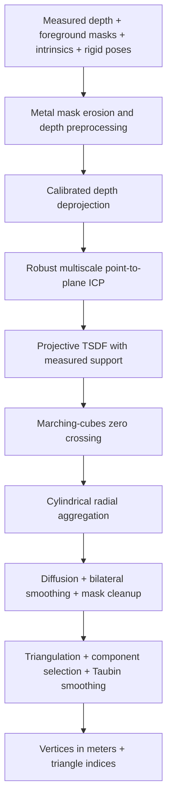

# TrueDepth Reconstruction

**Measured depth → robust registration → a dense 3D facial surface.**

English · [简体中文](README.zh-CN.md)

A focused Swift + Metal extraction of the measured-depth reconstruction algorithm developed for **TrueMyFace**. The interesting part is how noisy, imperfectly registered depth frames become one coherent surface: robust point-to-plane alignment, projective TSDF fusion, and cylindrical remeshing work together instead of directly triangulating a stack of noisy point clouds.

This repository contains the reconstruction core, minimal mathematical input/output types, synthetic tests, and an analytic demo. It contains no application UI, capture-session implementation, scoring, persistence, server code, network client, credentials, or recorded face data. It has its own history, independent of the application repository.

## What makes the pipeline interesting

### 1. Registration that refines tracking poses

Initial camera/face transforms establish a common coordinate system. Coarse-to-fine **point-to-plane ICP** then corrects residual misalignment using **Tukey robust weights**. A growing oriented point cloud provides the initial reference; subsequent rounds align every frame to a shared averaged model.

The implementation includes a compact uniform grid for nearest-neighbor queries, cell-distance pruning, local covariance/Jacobi normal estimation, incremental voxel aggregation, and fixed-order parallel reductions of the 6×6 normal equations. These choices reduce repeated indexing and allocation in the CPU hot path.

### 2. TSDF fusion before remeshing

Directly combining depth clouds can leave multiple nearby shells. This pipeline integrates registered depth into a **projective truncated signed distance field (TSDF)** and extracts its zero crossing with **marching cubes** first.

Each frame contributes at most one vote per voxel. Sampling checks the facial mask, depth discontinuities, and original measurement support. Inpainted depth can aid preprocessing/registration but does not independently establish TSDF observation support. Grid bounds come from corrected measured points, with percentile outlier rejection and physical margins.

### 3. Cylindrical surface reconstruction

The TSDF surface is mapped to a data-derived vertical cylinder and aggregated in `(θ, y)` bins. Robust radial statistics, diffusion with fill-depth tracking, bilateral grid smoothing, mask morphology, and connected-region selection produce a regular surface grid. Interior gaps are filled only where a finite inferred radius exists; an outer facial boundary remains open.

The grid is directly triangulated, then cleaned with largest-component selection, Taubin smoothing, and vertex clustering when needed. This is a front facial surface, not a watertight full head.

### 4. GPU work where it matters

Metal kernels implement mask erosion, iterative depth preprocessing, calibrated deprojection, grid diffusion, bilateral grid smoothing, and mask morphology. ICP and TSDF integration run on the CPU. GPU initialization, allocation, encoding, and execution failures are surfaced as errors; the implementation does not silently substitute a template face.

### 5. Calibration-aware geometry

Depth intrinsics must be scaled to the actual depth-buffer resolution. Optional radial lens lookup tables support observed/rectified pixel conversion, numerical inversion, and nonuniform reference-image scaling. Projection and deprojection use matching conventions.

No ARKit face vertices, canonical mesh, blend-shape geometry, or face-shape prior is supplied to this core. A caller may obtain rigid registration from a tracker, but it must provide the measured depth and foreground mask independently.

## Pipeline



## Requirements

- macOS 14+ with a Metal-capable GPU for the command-line demo and tests.
- iOS 18+ for library integration; physical TrueDepth capture must be supplied by the integrating project.
- Swift tools 5.9+ and an Xcode toolchain/SDK supporting the chosen target. Swift 5 language mode is used.
- No third-party package dependencies or model downloads.

The package bundles Metal source and compiles it at runtime through `Bundle.module`. A working Metal device is required for the complete pipeline. Linux is not supported.

## Quick start

```sh
git clone https://github.com/porarrirr/truemyface-reconstruction.git
cd truemyface-reconstruction
swift test -c release
swift run -c release reconstruct-synthetic /tmp/synthetic-ellipsoid.obj
```

The demo analytically intersects camera rays with an ellipsoid, creates three synthetic depth frames in memory, and runs the full pipeline with the default reconstruction settings. It writes an OBJ only when an output path is provided. No camera access or downloaded data is involved.

Release optimization is recommended for reconstruction. A reference local run produced **43,470 vertices / 86,119 triangles**, using a **1.5 mm TSDF voxel**. These are synthetic-demo results, not an accuracy or speed benchmark; counts may vary with floating-point/toolchain differences.

## Swift integration

Add this repository as a local Swift package, or use its URL and a reviewed commit revision in your package dependencies. Import the `TrueDepthReconstruction` product.

```swift
import simd
import TrueDepthReconstruction

func reconstructSurface(
    depthMeters: [Float], foregroundMask: [Bool],
    width: Int, height: Int,
    depthIntrinsics: CameraIntrinsics,
    cameraFromFace: simd_float4x4
) throws -> FaceMesh? {
    let frame = FaceDepthKeyframe(
        timestamp: 0,
        depthValues: depthMeters, width: width, height: height,
        intrinsics: depthIntrinsics,
        cameraFromFace: cameraFromFace,
        faceMask: foregroundMask
    )
    return try Reconstruction.reconstruct(frames: [frame])?.mesh
}
```

For multiview reconstruction, pass several accepted, mutually overlapping frames in the same face-local coordinate system. The public entry point uses the core's production defaults. Run this synchronous, computationally expensive operation away from the main thread; callers should serialize reconstruction jobs to control peak memory.

`ReconstructionResult` provides the mesh, frame count, input point count, median translation correction, and actual TSDF voxel size. `nil` means insufficient supported geometry; malformed input and Metal failures throw. The package does not perform capture guidance, synchronization, expression screening, or automatic foreground segmentation.

### Input and coordinate contract

| Input | Contract |
|---|---|
| `depthValues` | Row-major Float depth in **meters**; array length is `width × height`. Nonfinite/nonpositive values represent missing depth. The core discards depth at or above 1.5 m. |
| `faceMask` | Exactly one Boolean per depth pixel; `true` marks the facial foreground. Supply a measured/image-derived foreground mask. |
| `intrinsics` | `fx`, `fy`, `cx`, `cy` in depth-buffer pixels, before optional lens rectification. Focal lengths must be positive. |
| `lens` | Optional lens calibration for the raw depth image. Use `nil` for rectified/pinhole input. LUT entries are relative radial magnifications, not pixel offsets; mappings must be valid and monotonic. |
| `cameraFromFace` | Column-major **rigid** transform from face-local to camera space: camera `+x` right, `+y` up, `-z` forward. Optical depth convention is `+x` right, `+y` down, `+z` forward. |
| face-local axes | `+x` lateral, `+y` up, `+z` toward the front of the face. Cylindrical remeshing assumes the face is upright in this frame. |
| `pose` / `timestamp` | Finite head yaw/pitch in degrees and relative time in seconds; used for stable frame ordering. `pose` does not supply surface geometry. |
| output | Face-local vertices in meters, flat `UInt32` triangle indices. Smoothing and gap filling mean vertices are estimates, not raw sensor samples. |

Masks, timestamps, calibration, and registration must correspond to the same depth samples. Tracking transforms cannot supply or replace missing facial shape.

## Default reconstruction parameters

| Stage | Default |
|---|---|
| Depth preprocessing | 2 mask erosions; up to 25 inpainting iterations; bilateral depth range σ = 4 mm |
| ICP | Target ~4,000 sample points/frame; correspondence distances 12 / 5 / 2 mm; 20 / 20 / 30 iterations with early exit |
| Shared-model refinement | 2 rounds; distances 4 / 1.5 mm; 20 / 30 iterations |
| TSDF | Nominal voxel 1.5 mm; truncation 7.5 mm; at least 1 contributing frame; maximum grid dimension 256 |
| Measured front crop | 60 mm behind the 99.5th percentile front reference |
| Cylindrical grid | 0.65° angular bins; 1 mm vertical bins; maximum fill depth 12 rings |
| Grid smoothing | 2 iterations; spatial radius 3 bins; range σ = 1.2 mm |
| Mesh finish | 3 Taubin iterations; vertex clustering above 200,000 vertices |

Voxel size can increase to respect the maximum grid dimension. Voxel/bin resolution is not a claim of sensor or reconstruction accuracy. The clustering target is not a guaranteed strict vertex-count cap.

## Source map

- [`Reconstruction.swift`](Sources/TrueDepthReconstruction/Reconstruction.swift): minimal public entry point and input validation.
- [`MeasuredFaceReconstructor.swift`](Sources/TrueDepthReconstruction/MeasuredFaceReconstructor.swift): pipeline, robust ICP, local normals, incremental oriented model, cylindrical triangulation.
- [`CompactUniformGrid.swift`](Sources/TrueDepthReconstruction/CompactUniformGrid.swift): contiguous spatial indexing and borrowed query views.
- [`MeasuredTSDFSurfaceReconstructor.swift`](Sources/TrueDepthReconstruction/MeasuredTSDFSurfaceReconstructor.swift): projective fusion, measured grid extent, physical front crop.
- [`MarchingCubes.swift`](Sources/TrueDepthReconstruction/MarchingCubes.swift): observed-cell surface extraction and shared-edge vertices.
- [`MeasuredDepthPreprocessor.metal`](Sources/TrueDepthReconstruction/MeasuredDepthPreprocessor.metal): GPU kernels, with Swift dispatch wrappers alongside it.
- [`CameraCalibration.swift`](Sources/TrueDepthReconstruction/CameraCalibration.swift): intrinsics scaling, lens LUT math, matching projection/deprojection.
- [`SyntheticDemo`](Sources/SyntheticDemo/main.swift): executable end-to-end example with artificial data only.

## Validation and limits

Tests cover synthetic sphere extraction, TSDF registration and vote semantics, masked/discontinuous/unsupported depth rejection, corrected measured bounds, physical cropping, invalid public inputs, lens round trips, GPU/CPU deprojection agreement, known-transform ICP recovery, and explicit Metal failure behavior. The analytic ellipsoid demo exercises the complete production-default path and OBJ export.

There are no public real-face fixtures or calibrated real-device accuracy benchmarks. This extraction passed 21 XCTest cases and the full analytic demo on an Apple Silicon Mac. The library also built for iOS Simulator (arm64 and x86_64). Physical iPhone capture and application integration are outside this repository's validation. Motion, expressions, poor calibration, foreground-mask errors, and insufficient viewpoint overlap can still distort or prevent reconstruction. Cylindrical parameterization cannot represent arbitrary overhangs or a complete head. Diffusion and smoothing may alter fine detail.

To reproduce the iOS Simulator compile check:

```sh
xcodebuild -scheme TrueDepthReconstruction \
  -destination 'generic/platform=iOS Simulator' \
  -derivedDataPath /tmp/truedepth-reconstruction-build \
  CODE_SIGNING_ALLOWED=NO build
```

Before publishing changes, run `python3 Tools/audit_publication.py` as well as the tests. The audit enforces the publication file allowlist and checks source for forbidden app/network imports, endpoint literals, credential patterns, and local paths. It supplements manual review; it is not a general secret scanner.

## Source availability

Copyright © 2026 porarrirr. This is a public source publication with **all rights reserved**; no general reuse, redistribution, or commercial-use license is granted. See [LICENSE](LICENSE). Public visibility does not license the TrueMyFace application, branding, or private assets.
