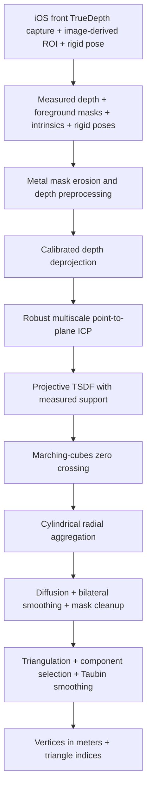

# TrueDepth Reconstruction

**TrueDepth camera → local calibration → robust registration → a dense 3D facial surface.**

English · [简体中文](README.zh-CN.md)

A focused Swift + Metal extraction of the measured-depth reconstruction algorithm developed for **TrueMyFace**. The interesting part is how noisy, imperfectly registered depth frames become one coherent surface: robust point-to-plane alignment, projective TSDF fusion, and cylindrical remeshing work together instead of directly triangulating a stack of noisy point clouds.

This repository contains the reconstruction core, an isolated iOS TrueDepth capture adapter, a newly written minimal iPhone sample, synthetic tests, and an analytic demo. It contains no TrueMyFace application UI or app infrastructure, scoring, database persistence, server code, network client, credentials, or recorded face data. It has its own history, independent of the application repository.

## What makes the pipeline interesting

### 1. Registration that refines tracking poses

Initial camera/face transforms establish a common coordinate system. Coarse-to-fine **point-to-plane ICP** then corrects residual misalignment using **Tukey robust weights**. A growing oriented point cloud provides the initial reference; subsequent rounds align every frame to a shared averaged model.

The implementation includes a compact uniform grid for nearest-neighbor queries, cell-distance pruning, local covariance/Jacobi normal estimation, incremental voxel aggregation, and fixed-order parallel reductions of the 6×6 normal equations. These choices reduce repeated indexing and allocation in the CPU hot path.

### 2. TSDF fusion before remeshing

Directly combining depth clouds can leave multiple nearby shells. This pipeline integrates registered depth into a **projective truncated signed distance field (TSDF)** and extracts its zero crossing with **marching cubes** first.

Each frame contributes at most one vote per voxel. Sampling checks the facial mask, depth discontinuities, and original measurement support. Inpainted depth can aid preprocessing/registration but does not independently establish TSDF observation support. Grid bounds come from corrected measured points, with percentile outlier rejection and physical margins.

### 3. Cylindrical surface reconstruction

The TSDF surface is mapped to a data-derived vertical cylinder and aggregated in `(θ, y)` bins. Robust radial statistics, diffusion with fill-depth tracking, bilateral grid smoothing, mask morphology, and connected-region selection produce a regular surface grid. Interior gaps are filled only where a finite inferred radius exists; an outer facial boundary remains open.

The grid is directly triangulated, then cleaned with largest-component selection, Taubin smoothing, and vertex clustering when needed. This is a front facial surface, not a watertight full head.

### 4. GPU work where it matters

Metal kernels implement mask erosion, iterative depth preprocessing, calibrated deprojection, grid diffusion, bilateral grid smoothing, and mask morphology. ICP and TSDF integration run on the CPU. GPU initialization, allocation, encoding, and execution failures are surfaced as errors; the implementation does not silently substitute a template face.

### 5. Calibration-aware geometry

Depth intrinsics must be scaled to the actual depth-buffer resolution. Optional radial lens lookup tables support observed/rectified pixel conversion, numerical inversion, and nonuniform reference-image scaling. Projection and deprojection use matching conventions.

The package also includes **local calibration assembly and detailed validation**. `TrueDepthCalibration` scales the SDK intrinsics and lens center, preserves the lookup-table reference radius, and decodes the two Float32 tables. `TrueDepthCalibrationValidator` checks nonfinite values, positive focal lengths, lookup coordinate metadata, table byte lengths, and the derivative of the interpolated radial mapping (including foldovers between knots). When both tables exist, sampled round trips report p95/max errors in both directions. Structural errors reject calibration; disagreement between otherwise valid direct tables remains an observable warning, matching the original algorithm.

The AVFoundation adapter only reads the calibration object already provided by the caller. Calibration construction and validation run entirely in memory. No telemetry, upload/export record, network request, remote configuration, device identifier collection, or server dependency is included. The calibration fingerprint is a local deterministic change marker, not a cryptographic identity or authentication mechanism.

No ARKit face vertices, canonical mesh, blend-shape geometry, or face-shape prior is supplied to this core. A caller may obtain rigid registration from a tracker, but it must provide the measured depth and foreground mask independently.

## Pipeline



## Requirements

- macOS 14+ with a Metal-capable GPU for the command-line demo and tests.
- iOS 18+ and a supported physical front TrueDepth iPhone for `TrueDepthCapture` and the camera sample. The sample is portrait-only. Simulator can build and test helper logic but cannot supply camera depth.
- Swift tools 5.9+ and an Xcode toolchain/SDK supporting the chosen target. Swift 5 language mode is used.
- No third-party package dependencies or model downloads.

The package bundles Metal source and compiles it at runtime through `Bundle.module`. A working Metal device is required for the complete pipeline. Linux is not supported.

## Quick start

```sh
git clone https://github.com/porarrirr/truemyface-reconstruction.git
cd truemyface-reconstruction
swift test -c release
swift run -c release reconstruct-synthetic /tmp/synthetic-ellipsoid.obj
```

The demo analytically intersects camera rays with an ellipsoid, creates three synthetic depth frames in memory, and runs the full pipeline with the default reconstruction settings. It writes an OBJ only when an output path is provided. No camera access or downloaded data is involved.

Release optimization is recommended for reconstruction. A reference local run produced **43,470 vertices / 86,119 triangles**, using a **1.5 mm TSDF voxel**. These are synthetic-demo results, not an accuracy or speed benchmark; counts may vary with floating-point/toolchain differences.

## Run the camera-to-mesh sample on iPhone

The sample in [`Examples/TrueDepthCaptureDemo`](Examples/TrueDepthCaptureDemo) is a **new minimal harness**, not a copy of the TrueMyFace UI. It starts the camera, reports five-direction coverage, reconstructs a mesh, and lets you share an OBJ. No account, backend, or network setup is required.

With XcodeGen installed, generate its project from the checked-in `project.yml`:

```sh
cd Examples/TrueDepthCaptureDemo
xcodegen generate
open TrueDepthCaptureDemo.xcodeproj
```

1. In Xcode, choose your signing team and a unique bundle identifier, then select a supported physical iPhone. The scheme runs **Release** for practical reconstruction performance.
2. Hold the device in **portrait** orientation. Tap **Start camera scan** and grant camera permission. Keep one neutral face about 20–50 cm from the front camera.
3. Begin facing forward, then slowly look left, right, up, and down. Keep the phone steady. The sample shows two accepted frames per direction; full coverage (10 frames) automatically stops capture and reconstructs.
4. Alternatively, tap **Stop and reconstruct** after at least five accepted frames across at least three directions, including the front. Insufficient coverage fails explicitly. Capture times out after 45 seconds.
5. After reconstruction, the sample reports mesh counts and offers **Share generated OBJ**. Vertices use meters. No raw scan fixture is included in the repository.

**Cancel capture**, backgrounding the sample, session interruption, or a tracked-face identity change discards the current capture. In-progress reconstruction runs to completion; it cannot be interrupted by `cancel()`. The camera is paused before reconstruction. Simulator start attempts report unsupported hardware rather than substituting a synthetic scan.

The adapter retains selected depth frames in memory. Camera images are used transiently for local Vision detection and are not saved. The sample writes the generated OBJ to the app's temporary directory after completion and removes the previous sample OBJ when another scan starts. Sharing is an explicit user action. Neither the adapter nor the sample includes uploads, telemetry, server endpoints, authentication, remote configuration, or network clients.

### Capture product integration

Add the `TrueDepthCapture` and `TrueDepthReconstruction` products to your own iOS app. Supply `NSCameraUsageDescription` in its Info.plist and keep the capture interface in portrait. Retain the scanner for the scan's lifetime:

```swift
import TrueDepthCapture

final class CaptureOwner {
    private let scanner = TrueDepthScanner { event in
        // Called on the main queue. Forward progress/errors to your own interface.
        switch event {
        case .completed(let result): print("Generated vertices:", result.mesh.vertexCount)
        case .failed(let error): print(error.localizedDescription)
        default: break
        }
    }

    func start() { scanner.start() }
    func stopAndReconstruct() { scanner.finish() }
    func cancelCapture() { scanner.cancel() }
}
```

`TrueDepthScanner` is available on iOS only; the pure capture helpers can be tested on macOS. The reconstruction-only product does not import ARKit, Vision, or SwiftUI. The capture product contains no UI. Its small sample is the only file importing SwiftUI.

### Capture data path and scope

- The adapter explicitly selects a front `.builtInTrueDepthCamera` AR face-tracking video format. Face tracking alone is insufficient: [Apple documents that captured depth requires a TrueDepth face-tracking format](https://developer.apple.com/documentation/arkit/arconfiguration/videoformat-swift.class/capturedevicetype).
- Only tracked-face **rigid transforms and identity** are read. No tracking facial vertices, topology, blend-shape geometry, or shape prior is read or used.
- `capturedDepthData` is converted to Float32 meters; padded rows are copied correctly. Absolute metric depth and its own calibration are required. Missing, duplicate, out-of-order, or more than 120 ms misaligned depth timestamps are rejected. Depth and RGB timestamps are not assumed equal; [Apple describes their differing cadence](https://developer.apple.com/documentation/arkit/arframe/captureddepthdatatimestamp).
- Vision supplies a 2D face rectangle from the corresponding RGB frame in portrait orientation. A conservatively inset 2D ellipse and a depth-connected foreground component create the mask. This clips the ROI; it supplies no 3D facial shape. Depth gating uses 0.15–0.65 m, an 85 mm band around the center median, and 12 mm adjacent-pixel continuity.
- At most one retained camera frame is processed at a time; excess incoming frames are dropped. Accepted samples are at least 250 ms apart. Selection is bounded to two frames per direction, with angular/time diversity for the second frame.
- Selected depth, masks, calibration, and rigid transforms go directly to the existing reconstruction core with its default settings. Capture stops before the expensive reconstruction work runs on its worker queue.

This is a small reference capture adapter, not the full application's quality/acceptance system. It has no preview renderer, expression screening, production capture guidance, saved scan database, or scoring. Its simple foreground mask can crop facial edges or fail on occlusions, strong motion, and poor depth. Physical-device quality and RGB/depth registration must be validated on the target device; compilation and synthetic tests do not establish real-scan accuracy.

## Swift integration

Add this repository as a local Swift package, or use its URL and a reviewed commit revision in your package dependencies. Import the `TrueDepthReconstruction` product.

```swift
import simd
import TrueDepthReconstruction

func reconstructSurface(
    depthMeters: [Float], foregroundMask: [Bool],
    width: Int, height: Int,
    depthIntrinsics: CameraIntrinsics,
    cameraFromFace: simd_float4x4
) throws -> FaceMesh? {
    let frame = FaceDepthKeyframe(
        timestamp: 0,
        depthValues: depthMeters, width: width, height: height,
        intrinsics: depthIntrinsics,
        cameraFromFace: cameraFromFace,
        faceMask: foregroundMask
    )
    return try Reconstruction.reconstruct(frames: [frame])?.mesh
}
```

For multiview reconstruction, pass several accepted, mutually overlapping frames in the same face-local coordinate system. The public entry point uses the core's production defaults. Run this synchronous, computationally expensive operation away from the main thread; callers should serialize reconstruction jobs to control peak memory.

`ReconstructionResult` provides the mesh, frame count, input point count, median translation correction, and actual TSDF voxel size. `nil` means insufficient supported geometry; malformed input and Metal failures throw. This reconstruction entry point accepts already prepared frames. For the reference camera acquisition, timing checks, and foreground masking, use the separate `TrueDepthCapture` product; it does not include expression screening or the original application's guidance system.

### Build calibration from the local SDK object

```swift
import AVFoundation
import simd
import TrueDepthReconstruction

func projectionForDepth(
    _ calibration: AVCameraCalibrationData,
    depthWidth: Int, depthHeight: Int
) throws -> TrueDepthProjectionModel {
    try TrueDepthCalibration.makeProjectionModel(
        calibration: calibration,
        depthImageSize: SIMD2(Float(depthWidth), Float(depthHeight))
    )
}
```

Use the calibration attached to the corresponding depth image; pass the returned `intrinsics` **and** `lens` into each `FaceDepthKeyframe`. Inspect `validation.warnings` when present. The same factory has a raw-value overload accepting the intrinsic matrix, reference dimensions, lens center, and lookup-table bytes, so its complete math can be tested without a camera.

The factory requires valid lens calibration and throws for missing tables; it never silently replaces raw-depth calibration with a pinhole model. For genuinely rectified/pinhole input, construct frames with the appropriate intrinsics and `lens: nil`. Do not rectify the same input twice. `Reconstruction.reconstruct` also applies detailed structural lens validation before starting GPU work.

Within the reconstruction product, the only AVFoundation import is isolated in the small calibration adapter; its math and validator use Foundation/simd. The separate `TrueDepthCapture` product supplies the reference acquisition/masking/session path above. Detailed image-to-depth alignment verification and application-specific acceptance policies remain the integrating project's responsibility. No recorded device calibration tables are bundled; tests and the demo use artificial tables.

### Input and coordinate contract

| Input | Contract |
|---|---|
| `depthValues` | Row-major Float depth in **meters**; array length is `width × height`. Nonfinite/nonpositive values represent missing depth. The core discards depth at or above 1.5 m. |
| `faceMask` | Exactly one Boolean per depth pixel; `true` marks the facial foreground. Supply a measured/image-derived foreground mask. |
| `intrinsics` | `fx`, `fy`, `cx`, `cy` in depth-buffer pixels, before optional lens rectification. Focal lengths must be positive. |
| `lens` | Optional lens calibration for the raw depth image. Use `nil` for rectified/pinhole input. LUT entries are relative radial magnifications, not pixel offsets; mappings must be valid and monotonic. |
| `cameraFromFace` | Column-major **rigid** transform from face-local to camera space: camera `+x` right, `+y` up, `-z` forward. Optical depth convention is `+x` right, `+y` down, `+z` forward. |
| face-local axes | `+x` lateral, `+y` up, `+z` toward the front of the face. Cylindrical remeshing assumes the face is upright in this frame. |
| `pose` / `timestamp` | Finite head yaw/pitch in degrees and relative time in seconds; used for stable frame ordering. `pose` does not supply surface geometry. |
| output | Face-local vertices in meters, flat `UInt32` triangle indices. Smoothing and gap filling mean vertices are estimates, not raw sensor samples. |

Masks, timestamps, calibration, and registration must correspond to the same depth samples. Tracking transforms cannot supply or replace missing facial shape.

## Default reconstruction parameters

| Stage | Default |
|---|---|
| Depth preprocessing | 2 mask erosions; up to 25 inpainting iterations; bilateral depth range σ = 4 mm |
| ICP | Target ~4,000 sample points/frame; correspondence distances 12 / 5 / 2 mm; 20 / 20 / 30 iterations with early exit |
| Shared-model refinement | 2 rounds; distances 4 / 1.5 mm; 20 / 30 iterations |
| TSDF | Nominal voxel 1.5 mm; truncation 7.5 mm; at least 1 contributing frame; maximum grid dimension 256 |
| Measured front crop | 60 mm behind the 99.5th percentile front reference |
| Cylindrical grid | 0.65° angular bins; 1 mm vertical bins; maximum fill depth 12 rings |
| Grid smoothing | 2 iterations; spatial radius 3 bins; range σ = 1.2 mm |
| Mesh finish | 3 Taubin iterations; vertex clustering above 200,000 vertices |

Voxel size can increase to respect the maximum grid dimension. Voxel/bin resolution is not a claim of sensor or reconstruction accuracy. The clustering target is not a guaranteed strict vertex-count cap.

## Source map

- [`TrueDepthScanner.swift`](Sources/TrueDepthCapture/TrueDepthScanner.swift): camera permission, TrueDepth session, local frame/calibration/Vision processing, lifecycle, and reconstruction handoff.
- [`CaptureFrameSelection.swift`](Sources/TrueDepthCapture/CaptureFrameSelection.swift): bounded frame ingress, timing, portrait pose, and balanced viewpoint selection.
- [`DepthForegroundMask.swift`](Sources/TrueDepthCapture/DepthForegroundMask.swift): 2D ROI mapping and measured-depth connected foreground.
- [`DepthBufferReader.swift`](Sources/TrueDepthCapture/DepthBufferReader.swift): stride-aware Float32 depth copying and distance gating.
- [`Camera sample`](Examples/TrueDepthCaptureDemo/CaptureDemoApp.swift): new minimal UI, local OBJ output, and explicit sharing.
- [`Reconstruction.swift`](Sources/TrueDepthReconstruction/Reconstruction.swift): minimal public entry point and input validation.
- [`MeasuredFaceReconstructor.swift`](Sources/TrueDepthReconstruction/MeasuredFaceReconstructor.swift): pipeline, robust ICP, local normals, incremental oriented model, cylindrical triangulation.
- [`CompactUniformGrid.swift`](Sources/TrueDepthReconstruction/CompactUniformGrid.swift): contiguous spatial indexing and borrowed query views.
- [`MeasuredTSDFSurfaceReconstructor.swift`](Sources/TrueDepthReconstruction/MeasuredTSDFSurfaceReconstructor.swift): projective fusion, measured grid extent, physical front crop.
- [`MarchingCubes.swift`](Sources/TrueDepthReconstruction/MarchingCubes.swift): observed-cell surface extraction and shared-edge vertices.
- [`MeasuredDepthPreprocessor.metal`](Sources/TrueDepthReconstruction/MeasuredDepthPreprocessor.metal): GPU kernels, with Swift dispatch wrappers alongside it.
- [`TrueDepthCalibration.swift`](Sources/TrueDepthReconstruction/TrueDepthCalibration.swift): local calibration assembly and safe Float32 table decoding.
- [`TrueDepthCalibration+AVFoundation.swift`](Sources/TrueDepthReconstruction/TrueDepthCalibration+AVFoundation.swift): read-only SDK calibration adapter.
- [`TrueDepthCalibrationValidator.swift`](Sources/TrueDepthReconstruction/TrueDepthCalibrationValidator.swift): monotonicity, coordinate metadata, composition errors, and local fingerprint.
- [`CameraCalibration.swift`](Sources/TrueDepthReconstruction/CameraCalibration.swift): intrinsics scaling, lens LUT math, matching projection/deprojection.
- [`SyntheticDemo`](Sources/SyntheticDemo/main.swift): executable end-to-end example with artificial data only.

## Validation and limits

Tests cover synthetic sphere extraction, TSDF registration and vote semantics, masked/discontinuous/unsupported depth rejection, corrected measured bounds, physical cropping, invalid public inputs, lens round trips, GPU/CPU deprojection agreement, known-transform ICP recovery, and explicit Metal failure behavior. The analytic ellipsoid demo exercises the complete production-default path and OBJ export.

There are no public real-face fixtures or calibrated real-device accuracy benchmarks. The core and capture helpers passed 48 XCTest cases on an Apple Silicon Mac, and the analytic reconstruction demo passed. The new camera sample built in Release for generic iOS devices and iOS Simulator. A physical iPhone was not available for an actual camera scan, so real capture, foreground quality, timing, and device-specific registration remain unverified. Motion, expressions, poor calibration, foreground-mask errors, and insufficient viewpoint overlap can still distort or prevent reconstruction. Cylindrical parameterization cannot represent arbitrary overhangs or a complete head. Diffusion and smoothing may alter fine detail.

The 10 capture-helper tests also passed on iOS Simulator. The sample has a UI test that verifies a Simulator scan reports unsupported hardware, re-enables Start, and produces no synthetic OBJ. This does not test a physical camera.

To build the sample for a physical-device SDK without signing, or run its Simulator UI test:

```sh
xcodegen generate --spec Examples/TrueDepthCaptureDemo/project.yml
xcodebuild -project Examples/TrueDepthCaptureDemo/TrueDepthCaptureDemo.xcodeproj \
  -scheme TrueDepthCaptureDemo -configuration Release \
  -destination 'generic/platform=iOS' \
  -derivedDataPath /tmp/truedepth-camera-device-build CODE_SIGNING_ALLOWED=NO build
xcodebuild -project Examples/TrueDepthCaptureDemo/TrueDepthCaptureDemo.xcodeproj \
  -scheme TrueDepthCaptureDemo \
  -destination 'platform=iOS Simulator,name=iPhone 18 Pro' \
  -derivedDataPath /tmp/truedepth-camera-ui-tests CODE_SIGNING_ALLOWED=NO test
```

Replace the Simulator name with one installed in your Xcode if needed.

To reproduce the iOS Simulator compile check:

```sh
xcodebuild -scheme TrueDepthReconstruction \
  -destination 'generic/platform=iOS Simulator' \
  -derivedDataPath /tmp/truedepth-reconstruction-build \
  CODE_SIGNING_ALLOWED=NO build
```

Before publishing changes, run `python3 Tools/audit_publication.py` as well as the tests. The audit enforces the publication file allowlist and checks source for forbidden app/network imports, endpoint literals, credential patterns, and local paths. It supplements manual review; it is not a general secret scanner.

## License

Copyright © 2026 porarrirr. The code and documentation in this repository are licensed under the [MIT License](LICENSE). The separate TrueMyFace application, branding, private source code, assets, and data are outside the scope of this license.
