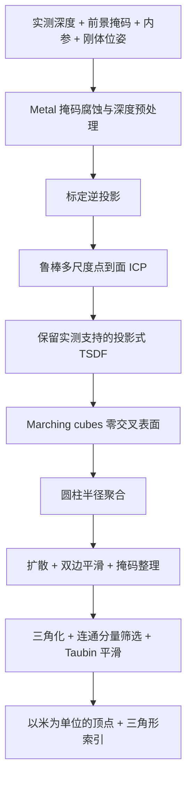

# TrueDepth Reconstruction

**实测深度 → 鲁棒配准 → 高密度三维人脸表面。**

[English](README.md) · 简体中文

这是从 **TrueMyFace** 中独立提取的 Swift + Metal 深度重建算法。核心技术在于将带有噪声、初始位姿不完全准确的多帧深度转化为一致的表面：先进行鲁棒点到面配准，再进行投影式 TSDF 融合，最后通过圆柱坐标重新构建网格，避免直接三角化多层噪声点云。

本仓库仅包含重建核心、最小数学输入/输出类型、人工数据测试和解析几何演示。不包含应用 UI、采集会话实现、评分、持久化、服务端代码、网络客户端、凭据或真实人脸数据。仓库拥有独立历史，不继承应用仓库的提交记录。

## 技术亮点

### 1. 对初始跟踪位姿进行进一步配准

相机/人脸的初始刚体变换用于建立公共坐标系。随后使用由粗到细的**点到面 ICP** 和 **Tukey 鲁棒权重**修正残余错位。逐步增长的有向点云提供初始参考，后续轮次再将所有帧配准到共同的平均模型。

实现包括紧凑均匀网格近邻索引、基于网格距离的剪枝、局部协方差/Jacobi 法线估计、增量体素聚合，以及固定归并顺序的 6×6 正规方程并行归约，减少 CPU 热路径中的重复索引构建和内存分配。

### 2. 先融合 TSDF，再重新构建表面

直接叠加深度点云可能形成相邻的多层表面。本流程先把配准后的深度融合到**投影式截断符号距离场（TSDF）**，再通过 **marching cubes** 提取零交叉表面。

每帧对每个体素最多贡献一次观测。采样时检查人脸前景掩码、深度不连续以及原始实测支持。插补深度可以辅助预处理和配准，但不能单独建立 TSDF 的观测支持。体素网格范围由修正后的实测点决定，并结合百分位异常值剔除与物理距离边距。

### 3. 圆柱坐标下的表面重建

将 TSDF 表面映射到由数据确定的竖直圆柱，在 `(θ, y)` 网格中聚合。通过鲁棒半径统计、带填充深度记录的扩散、双边平滑、掩码形态学及连通区域筛选，形成规则表面网格。内部缺口仅在存在有限推断半径时填充；人脸外边界保持开放。

规则网格直接三角化，再执行最大连通分量筛选、Taubin 平滑，并在必要时进行顶点聚类。这是人脸前部表面，不是封闭的完整头部模型。

### 4. 在合适的阶段使用 GPU

Metal 内核负责掩码腐蚀、迭代深度预处理、标定逆投影、网格扩散、双边网格平滑以及掩码形态学。ICP 和 TSDF 融合在 CPU 上执行。GPU 初始化、资源分配、编码或执行失败会明确抛出错误，不会悄悄替换为模板人脸。

### 5. 考虑标定与镜头畸变

深度相机内参必须缩放到实际深度缓冲区分辨率。可选的径向畸变查找表支持观测像素/校正像素转换、数值反演和参考图像的非等比例缩放，投影与逆投影采用一致约定。

本包还包含**完全本地的标定模型组装与详细验证**。`TrueDepthCalibration` 缩放 SDK 内参和畸变中心，保留查找表参考坐标中的最大半径，并解码两种 Float32 查找表。`TrueDepthCalibrationValidator` 检查非有限值、正焦距、查找表坐标元数据、原始字节长度和插值后径向映射的导数（包括节点之间的折返）。同时存在两张表时，通过采样往返转换报告双向 p95/最大误差。结构性错误会拒绝标定；结构有效但双表不一致时保留可查询警告，与原算法一致。

AVFoundation 适配器仅读取调用方已提供的标定对象。模型组装和验证均在内存中完成，不包含遥测、上传/导出记录、网络请求、远程配置、设备标识符采集或服务端依赖。标定指纹仅用于本地确定性变更检测，不是加密身份或认证机制。

本核心不接收 ARKit 人脸顶点、标准人脸网格、表情混合形状或人脸形状先验。调用方可以使用跟踪器提供刚体配准，但必须独立提供实测深度和前景掩码。

## 处理流程



## 环境要求

- 命令行演示和测试：macOS 14+，以及支持 Metal 的 GPU。
- 库集成：iOS 18+；真实 TrueDepth 采集由集成项目提供。
- Swift tools 5.9+，以及支持目标平台的 Xcode 工具链和 SDK。使用 Swift 5 语言模式。
- 无第三方 Swift 包依赖，无需下载模型。

包内附带 Metal 源码，通过 `Bundle.module` 读取并在运行时编译。完整流程需要可用的 Metal 设备。不支持 Linux。

## 快速开始

```sh
git clone https://github.com/porarrirr/truemyface-reconstruction.git
cd truemyface-reconstruction
swift test -c release
swift run -c release reconstruct-synthetic /tmp/synthetic-ellipsoid.obj
```

演示程序通过相机射线与椭球的解析交点，在内存中生成三帧人工深度，并使用默认重建配置运行完整流程。只有提供输出路径时才写入 OBJ。无需访问相机，也不下载数据。

建议使用 Release 优化。一次本地参考运行生成了 **43,470 个顶点 / 86,119 个三角形**，使用 **1.5 mm TSDF 体素**。这是人工演示结果，不是精度或速度基准；浮点运算或工具链差异可能影响数量。

## Swift 集成

可将本仓库作为本地 Swift package 添加，或在包依赖中使用仓库 URL 与经过审核的提交 revision。导入 `TrueDepthReconstruction` 产品。

```swift
import simd
import TrueDepthReconstruction

func reconstructSurface(
    depthMeters: [Float], foregroundMask: [Bool],
    width: Int, height: Int,
    depthIntrinsics: CameraIntrinsics,
    cameraFromFace: simd_float4x4
) throws -> FaceMesh? {
    let frame = FaceDepthKeyframe(
        timestamp: 0,
        depthValues: depthMeters, width: width, height: height,
        intrinsics: depthIntrinsics,
        cameraFromFace: cameraFromFace,
        faceMask: foregroundMask
    )
    return try Reconstruction.reconstruct(frames: [frame])?.mesh
}
```

多视角重建时，应传入处于同一人脸局部坐标系、相互覆盖且已经通过采集质量筛选的多帧深度。公开入口使用核心的生产默认参数。该调用是同步且计算密集的，应在主线程之外运行；为控制峰值内存，调用方应串行安排重建任务。

`ReconstructionResult` 包含网格、帧数、输入点数、位姿平移修正中位数和实际 TSDF 体素大小。返回 `nil` 表示支持的几何不足；格式错误和 Metal 故障会抛出错误。本包不执行采集引导、采集同步、表情筛选或自动前景分割。

### 从本地 SDK 对象组装标定模型

```swift
import AVFoundation
import simd
import TrueDepthReconstruction

func projectionForDepth(
    _ calibration: AVCameraCalibrationData,
    depthWidth: Int, depthHeight: Int
) throws -> TrueDepthProjectionModel {
    try TrueDepthCalibration.makeProjectionModel(
        calibration: calibration,
        depthImageSize: SIMD2(Float(depthWidth), Float(depthHeight))
    )
}
```

使用对应深度图所附带的标定对象，将返回的 `intrinsics` **和** `lens` 一起传入每个 `FaceDepthKeyframe`，并检查可能存在的 `validation.warnings`。该工厂也提供原始数值重载，接受内参矩阵、参考尺寸、畸变中心和查找表字节，因此无需相机即可测试完整计算过程。

工厂要求有效的镜头标定，缺少查找表会抛出错误，不会把原始深度的标定悄悄替换为针孔模型。对于确实已经校正/符合针孔模型的输入，可直接以正确内参和 `lens: nil` 构造帧；不要重复校正同一输入。`Reconstruction.reconstruct` 也会在 GPU 工作开始前进行详细的镜头结构验证。

唯一的 AVFoundation 导入隔离在小型 SDK 适配器中，数学计算和验证器只使用 Foundation/simd。帧采集、图像与深度对齐检查、前景分割和采集会话策略仍由调用方负责。本仓库不附带真实设备标定表；测试和演示使用人工表。

### 输入与坐标约定

| 输入 | 约定 |
|---|---|
| `depthValues` | 行优先 Float 深度，单位为**米**；长度为 `width × height`。非有限或非正值表示缺失深度。核心会丢弃大于等于 1.5 m 的深度。 |
| `faceMask` | 每个深度像素对应一个布尔值；`true` 表示人脸前景。应提供来自实测/图像的前景掩码。 |
| `intrinsics` | `fx`、`fy`、`cx`、`cy` 均以深度缓冲区像素为单位，对应可选镜头校正之前的坐标。焦距必须为正。 |
| `lens` | 原始深度图的可选镜头标定。已校正/针孔输入使用 `nil`。查找表值为相对径向放大率，不是像素偏移；映射必须有效且单调。 |
| `cameraFromFace` | 从人脸局部坐标到相机坐标的列优先**刚体**变换：相机 `+x` 向右、`+y` 向上、`-z` 向前。光学深度约定为 `+x` 向右、`+y` 向下、`+z` 向前。 |
| 人脸局部坐标轴 | `+x` 为横向、`+y` 向上、`+z` 朝向人脸前方。圆柱重建要求人脸在此坐标系中保持直立。 |
| `pose` / `timestamp` | 有限的头部偏航角/俯仰角，单位为度；相对时间单位为秒。用于稳定帧处理顺序，不提供表面形状。 |
| 输出 | 人脸局部坐标系中的顶点，单位为米；扁平 `UInt32` 三角形索引。平滑和缺口填充意味着顶点是估计值，并非原始传感器采样点。 |

掩码、时间戳、标定和配准必须对应同一组深度采样。跟踪变换不能提供或替代缺失的人脸形状。

## 默认参数

| 阶段 | 默认值 |
|---|---|
| 深度预处理 | 掩码腐蚀 2 次；最多插补 25 次；深度双边滤波值域 σ = 4 mm |
| ICP | 每帧目标约 4,000 个采样点；对应距离 12 / 5 / 2 mm；20 / 20 / 30 次迭代，支持提前退出 |
| 共享模型细化 | 2 轮；对应距离 4 / 1.5 mm；20 / 30 次迭代 |
| TSDF | 标称体素 1.5 mm；截断距离 7.5 mm；至少 1 帧观测；最大网格维度 256 |
| 实测前部裁剪 | 保留至前方参考值（第 99.5 百分位）后方 60 mm |
| 圆柱网格 | 角度间隔 0.65°；高度间隔 1 mm；最大填充深度 12 圈 |
| 网格平滑 | 2 次；空间半径 3 个网格单元；值域 σ = 1.2 mm |
| 网格整理 | Taubin 平滑 3 次；超过 200,000 个顶点时执行顶点聚类 |

为满足最大网格维度，实际体素大小可能增大。体素/网格分辨率并不代表传感器或重建精度。聚类目标不保证严格限制最终顶点数量。

## 源码导航

- [`Reconstruction.swift`](Sources/TrueDepthReconstruction/Reconstruction.swift)：最小公开接口与输入验证。
- [`MeasuredFaceReconstructor.swift`](Sources/TrueDepthReconstruction/MeasuredFaceReconstructor.swift)：整体流程、鲁棒 ICP、局部法线、增量有向模型、圆柱三角化。
- [`CompactUniformGrid.swift`](Sources/TrueDepthReconstruction/CompactUniformGrid.swift)：连续存储的空间索引及借用查询视图。
- [`MeasuredTSDFSurfaceReconstructor.swift`](Sources/TrueDepthReconstruction/MeasuredTSDFSurfaceReconstructor.swift)：投影式融合、实测范围和物理距离裁剪。
- [`MarchingCubes.swift`](Sources/TrueDepthReconstruction/MarchingCubes.swift)：仅对已观测单元提取表面，并共享边顶点。
- [`MeasuredDepthPreprocessor.metal`](Sources/TrueDepthReconstruction/MeasuredDepthPreprocessor.metal)：GPU 内核；同目录的 Swift 文件负责调度。
- [`TrueDepthCalibration.swift`](Sources/TrueDepthReconstruction/TrueDepthCalibration.swift)：本地标定组装及安全的 Float32 表解码。
- [`TrueDepthCalibration+AVFoundation.swift`](Sources/TrueDepthReconstruction/TrueDepthCalibration+AVFoundation.swift)：只读 SDK 标定适配器。
- [`TrueDepthCalibrationValidator.swift`](Sources/TrueDepthReconstruction/TrueDepthCalibrationValidator.swift)：单调性、坐标元数据、往返误差和本地指纹。
- [`CameraCalibration.swift`](Sources/TrueDepthReconstruction/CameraCalibration.swift)：内参缩放、镜头查找表、对应的投影与逆投影。
- [`SyntheticDemo`](Sources/SyntheticDemo/main.swift)：仅使用人工数据的完整可执行示例。

## 验证与限制

测试覆盖人工球面提取、TSDF 配准与投票语义、掩码/深度断层/无实测支持的拒绝、修正后的实测边界、物理距离裁剪、公开接口的无效输入、镜头往返转换、GPU/CPU 逆投影一致性、已知刚体变换的 ICP 恢复，以及明确的 Metal 失败行为。解析椭球演示覆盖完整生产默认流程和 OBJ 导出。

本仓库不包含真实人脸测试数据，也不提供真实设备的标定精度基准。本次独立提取在 Apple Silicon Mac 上通过 38 项 XCTest 和完整解析演示，并通过 iOS Simulator（arm64 和 x86_64）库构建。实体 iPhone 采集和应用集成不在本仓库的验证范围内。运动、表情、标定不准、前景掩码错误、视角覆盖不足仍可能导致失真或重建失败。圆柱参数化无法表示任意悬垂结构或完整头部；扩散和平滑也可能改变细节。

可使用以下命令复现 iOS Simulator 编译检查：

```sh
xcodebuild -scheme TrueDepthReconstruction \
  -destination 'generic/platform=iOS Simulator' \
  -derivedDataPath /tmp/truedepth-reconstruction-build \
  CODE_SIGNING_ALLOWED=NO build
```

发布修改之前，除测试外还应执行 `python3 Tools/audit_publication.py`。该检查强制执行公开文件白名单，并检查源码中的禁用应用/网络导入、端点字面量、凭据模式和本地路径。它是人工审核的补充，不是通用秘密扫描器。

## 源码公开与权利

Copyright © 2026 porarrirr。本仓库为**保留所有权利**的公开源码展示，不授予一般性复用、再分发或商业使用许可。详见 [LICENSE](LICENSE)。仓库公开并不授予对 TrueMyFace 应用、品牌或私有资源的许可。
